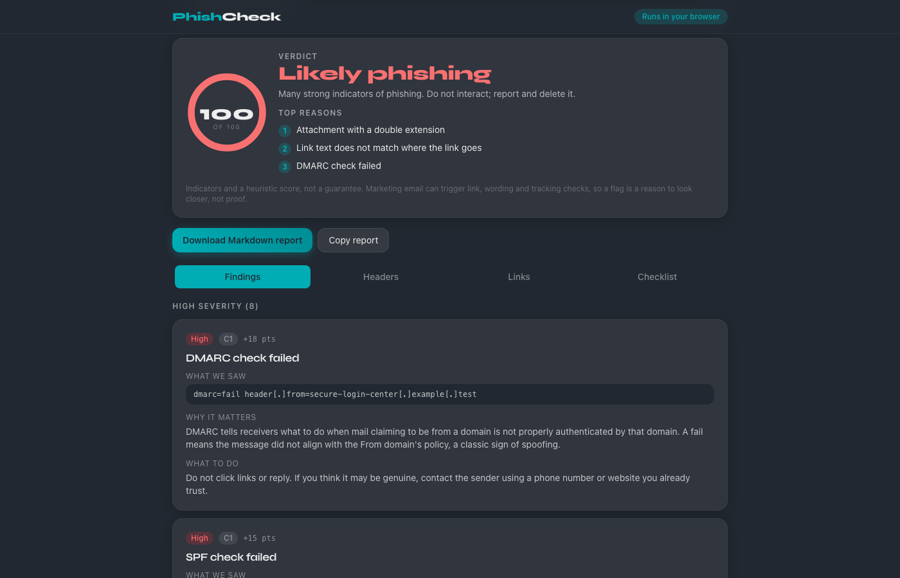
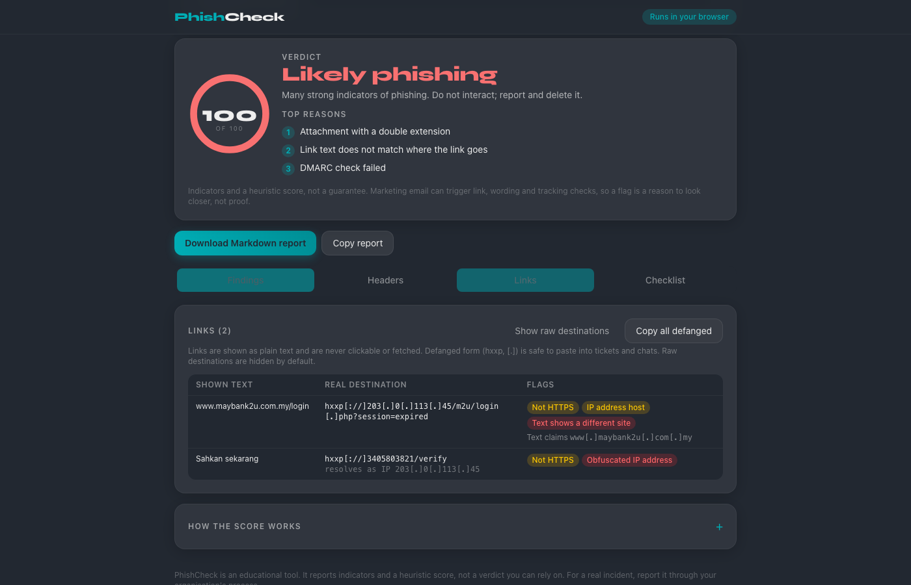
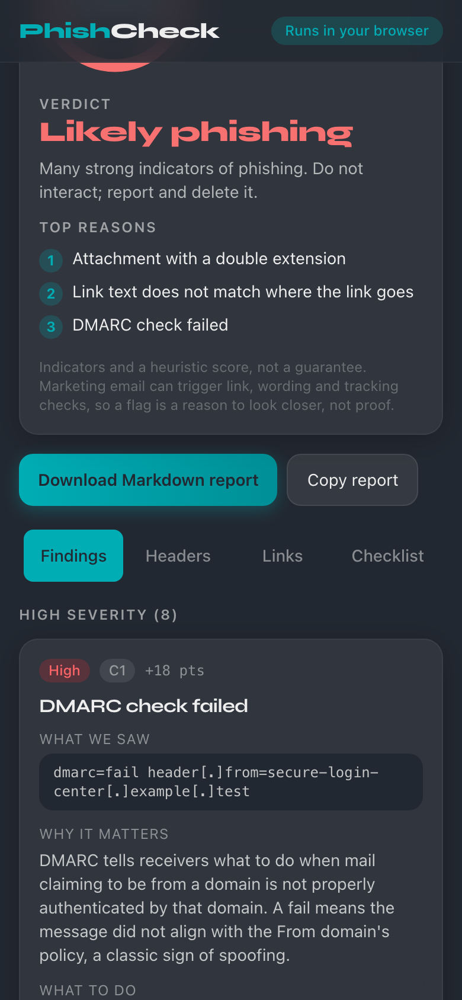

# PhishCheck

A client-side phishing email analyzer. Paste the raw source of a suspicious email (or drop an `.eml` file) and PhishCheck lists the specific red flags it found, explains each one in plain language, shows how to read the headers, and gives a **heuristic score** and verdict.

It reports **indicators and a heuristic score. It is not a guarantee** that a message is safe or malicious, it is not an email gateway, and it does not replace your organisation's phishing tooling or reporting process. There is no machine learning in it: every rule and every weight is listed below.







## Privacy model

- **Everything runs in your browser.** The email text is parsed and scored by JavaScript on your device. There is no backend, no upload, no analytics, no cookies and no storage (nothing is written to `localStorage` either).
- **No link is ever opened or fetched.** Links from the email are shown as plain text, defanged (`hxxps[://]example[.]test`), and are never rendered as clickable anchors.
- **Email HTML is never rendered.** Bodies are shown as escaped plain text. There is no `dangerouslySetInnerHTML`, no iframe, and no remote image is loaded (tracking pixels are detected statically from the source, never fetched). A repository test scans the source for these sinks.
- **The only optional network feature is off by default:** "Check DNS records" (DNS-over-HTTPS). When you switch it on, **only the sender's domain name** (and `_dmarc.` + that name) is sent over HTTPS to `cloudflare-dns.com`. That resolver sees your IP address and that domain. Message content, subject, addresses, links and attachments are never sent. The UI discloses this next to the switch.
- The shipped `public/_headers` sets a strict Content-Security-Policy (`default-src 'self'`, `img-src 'self' data:`, `connect-src https://cloudflare-dns.com` only because the optional DoH code is bundled), plus `X-Content-Type-Options: nosniff` and `Referrer-Policy: no-referrer`. Fonts (Syne) are bundled with the app, so no third-party font host is contacted.

### How to verify in DevTools

1. Open the app, open DevTools, go to the **Network** tab and tick "Preserve log". Clear it.
2. Load a sample or paste an email and click **Analyse**. No request should appear (after the initial page assets). Switch to the **Links** tab and click around: still nothing.
3. Switch on **Check DNS records**: you should see exactly three GET requests to `https://cloudflare-dns.com/dns-query?name=<sender domain>` (TXT, `_dmarc.` TXT and A). Nothing else.
4. In the **Elements** tab, search for `<script`, `<img` and `<iframe` inside `#root`: none come from the email.

## Using it

1. Get the raw source: Gmail, three dots, **Show original**, **Copy to clipboard**. Outlook on the web: three dots, View, **View message source** (desktop: File, Properties, Internet headers). Apple Mail: View, Message, **Raw Source**. A forwarded copy usually loses the original headers.
2. Paste into the box, or drop/choose an `.eml` file (max 2 MB), then **Analyse email**. Or load one of the three invented samples.
3. Read the verdict, the top three reasons, then the tabs: **Findings** (what we saw / why it matters / what to do), **Headers** (Received chain with per-hop delay, authentication table, sender identity table), **Links** (shown text, destination, defanged form, flags, copy-all-defanged), **Checklist** (safe actions for the verdict).
4. **Download Markdown report** or **Copy report**: verdict, score, findings and defanged indicators only. The message body is not included.

## The checks

| ID | Check | What it looks at |
|---|---|---|
| C1 | Authentication results | `Authentication-Results` (fallback `Received-SPF`): SPF, DKIM, DMARC pass/fail/softfail/error. |
| C2 | Sender mismatch | Organisational domain of `From` vs `Return-Path`, `Reply-To`, `Sender`. Subdomains of the same organisation are not a mismatch. |
| C3 | Display-name spoofing | A different email address inside the display name, or a brand name in the display name while the address is not on that brand's domains. |
| C4 | Lookalike domains | Sender, Reply-To, Return-Path and every link host: homoglyph normalisation (`0/o`, `1/l`, `rn/m`, `vv/w`, Cyrillic/Greek), punycode (`xn--`) decoding, Damerau-Levenshtein distance to a brand list (labels of 5+ characters), brand embedded in an unrelated domain, suspicious TLDs, 4+ subdomains. Real brand domains stay clean. |
| C5 | Link mismatch | HTML anchor text that looks like a URL/domain but whose `href` goes to a different organisation (or an IP). |
| C6 | Link hygiene | IP-address hosts, decimal/hex/octal IP forms, userinfo `@` tricks, shorteners, `data:`/`javascript:`, very long or heavily encoded URLs, plain `http`. |
| C7 | Urgency wording | English and Bahasa Malaysia phrase lists (suspension threats, deadlines, prizes, payment overdue). |
| C8 | Credential / payment requests | Passwords, OTP/TAC, card numbers, bank login, MyKad number; wire-transfer / pay-now pressure (EN and BM). |
| C9 | Attachment risk | By name and declared type only (never opened): executables/scripts, double extensions, HTML, macro Office files, disk images/shortcuts/archives, archive plus a password in the body. |
| C10 | Header anomalies | Missing `Message-ID`, unreadable or implausible `Date`, backwards `Received` timestamps, day-long hop delays. |
| C11 | Tracking and hidden content | 1x1 / hidden images, text hidden with CSS (size 0, display:none, white on white), more than 10 remote images. |
| C12 | Positive signals | Aligned SPF/DKIM/DMARC passes and consistent domains lower the score. Ignored when any high-severity finding or any C14 / C15 lure finding exists (attackers can pass authentication on a domain they own). |
| C13 | Executive impersonation | Display name carries an authority title or role (CEO, CFO, COO, MD, Director, President, Chairman, Boss, HR, Finance, Dato', Datuk, Tan Sri, Tuan, Puan, Pengarah, Pengerusi and similar; short acronyms are matched in capitals only; honorifics only at the start of the name) AND the address is on a free-mail provider (gmail.com, outlook.com, hotmail.com, yahoo.com, icloud.com, proton.me, protonmail.com, live.com, mail.com) OR the Reply-To organisation differs from From (department names such as HR, Finance and payroll only count when the address is on a free-mail provider, because company mailboxes often use a vendor in Reply-To). High severity. |
| C14 | Payment and secrecy lures | Counts how many different kinds of ask appear in the subject or body (text or HTML, English and Bahasa Malaysia): gift cards / voucher codes, wire or bank transfer, change of bank details, "are you available" / "quick favour" openers, secrecy ("keep this confidential", "jangan beritahu", "rahsiakan"), buy-and-send-codes, urgent request. 1 group is low, 2 medium, 3 or more high. A message with a `List-Unsubscribe` header needs 3 or more groups, so ordinary promotions that mention gift cards stay quiet. |
| C15 | QR-code lures | Wording that asks you to scan a QR code / use the phone camera to continue, verify, re-enrol MFA, pay or log in, in a message that has an image (inline or remote) and 0-2 links. Medium severity. The image is never decoded, only the wording is read. |
| COMBO | Combination bonuses | Added only when signals co-occur, each shown as its own finding: brand in display name + lookalike / brand-in-domain + link-text mismatch (+12); executive impersonation + C14 lure (+10). |
| DNS | Optional DNS check | Sender domain does not exist, or publishes no SPF / DMARC. Only when switched on. |

Marketing email can legitimately trigger C6, C7 and C11. That is why each finding explains itself and why the verdict is a band, not a yes/no.

## Scoring weights

Findings add (or, for good signs, subtract) the points below. Each check contributes at most its **cap**: C1 35, C2 20, C3 25, C4 40, C5 30, C6 20, C7 12, C8 22, C9 35, C10 8, C11 8, C13 18, C14 20, C15 15, COMBO 20, DNS 12. Good signs together lower the total by at most 20. The final score is clamped to 0-100. The same table is shown in the app under "How the score works" and is generated from `src/weights.ts`.

| Check | Finding | Points |
|---|---|---|
| C1 | DMARC fails | +18 |
| C1 | SPF fails | +15 |
| C1 | DKIM fails | +12 |
| C1 | SPF softfail | +8 |
| C1 | Authentication temperror / permerror | +4 |
| C1 | No authentication results in the headers | +4 |
| C2 | Reply-To domain differs from From | +12 |
| C2 | Return-Path domain differs from From | +10 |
| C2 | Sender header domain differs from From | +6 |
| C3 | Display name contains a different email address | +20 |
| C3 | Display name names a brand but the domain is not the brand's | +18 |
| C4 | Look-alike spelling of a brand (e.g. paypa1, rnicrosoft) | +30 |
| C4 | Punycode / non-Latin look-alike of a brand | +32 |
| C4 | Brand name misspelled by 1-2 characters | +24 |
| C4 | Brand name embedded in an unrelated domain | +16 |
| C4 | Brand label on a domain the brand does not own | +12 |
| C4 | Punycode (xn--) domain | +14 |
| C4 | Suspicious top-level domain | +8 |
| C4 | Excessive subdomains | +6 |
| C5 | Link text shows a different site than the link goes to (per link, capped for the check) | +20 |
| C6 | URL uses an IP address | +10 |
| C6 | URL uses a decimal / hex / octal IP | +14 |
| C6 | "@" (userinfo) in URL | +12 |
| C6 | data: or javascript: URL | +15 |
| C6 | URL shortener | +6 |
| C6 | Very long or heavily encoded URL | +4 |
| C6 | Link uses plain http | +3 |
| C7 | Urgency / pressure wording, 5 or more phrases | +12 |
| C7 | Urgency / pressure wording, 3-4 phrases | +8 |
| C7 | Urgency / pressure wording, 1-2 phrases | +4 |
| C8 | Asks for password / OTP / card / bank login | +18 |
| C8 | Pushes a payment or transfer | +8 |
| C9 | Executable / script attachment | +25 |
| C9 | Double extension (e.g. .pdf.exe) | +25 |
| C9 | HTML / HTM attachment | +15 |
| C9 | Macro-enabled Office attachment | +15 |
| C9 | Disk image / shortcut / archive attachment | +12 |
| C9 | Archive plus password mentioned in the body | +8 |
| C10 | Missing Message-ID | +4 |
| C10 | Date far in the future or past, or missing | +4 |
| C10 | Received chain timestamps go backwards | +3 |
| C10 | Very long delay between hops (over 24 h) | +2 |
| C11 | Hidden text via CSS | +5 |
| C11 | 1x1 / hidden tracking image | +3 |
| C11 | Many remote images (over 10) | +2 |
| C13 | Executive / authority title in the display name, sent from a free-mail address or with a Reply-To on another domain | +18 |
| C14 | Payment / gift-card / secrecy wording, 1 phrase group | +6 |
| C14 | Payment / gift-card / secrecy wording, 2 phrase groups | +14 |
| C14 | Payment / gift-card / secrecy wording, 3 or more phrase groups | +20 |
| C15 | Asks you to scan a QR code, message has an image and few or no links | +15 |
| COMBO | Combination: brand in display name + lookalike / brand-in-domain + link-text mismatch together | +12 |
| COMBO | Combination: executive impersonation + payment / gift-card / secrecy wording together | +10 |
| C12 | SPF, DKIM and DMARC all pass and align with From | -15 |
| C12 | Some authentication passes and aligns (no failures) | -6 |
| C12 | From, Return-Path and Reply-To domains consistent | -5 |
| DNS | Sender domain does not exist (optional DNS check) | +10 |
| DNS | Sender domain publishes no SPF record (optional DNS check) | +3 |
| DNS | Sender domain publishes no DMARC record (optional DNS check) | +3 |

| Score | Verdict |
|---|---|
| 0-24 | No obvious red flags (not a guarantee). Shown only when there are no medium or high findings; otherwise "Low risk" (minor medium finding) or the floor below |
| 25-49 | Be careful |
| 50-74 | Suspicious |
| 75-100 | Likely phishing |

**Verdict floor.** The number is never altered, but the verdict is raised to at least "Be careful" (and says why, in the app and in the report) when any of these is true: any high-severity finding exists; any single medium-severity finding is worth 12 or more points; or positive findings total 12 or more points across two or more different checks. This stops a low number from reading as reassurance when a serious indicator exists (for example a QR-code lure on an authenticated domain, where good signs would otherwise cancel the finding out).

The four samples score: obvious phish 100 (Likely phishing), lookalike-domain phish 72 (Suspicious), CEO gift-card scam 64 (Suspicious), legitimate newsletter 0 (No obvious red flags, with good signs).

## Samples

All four are invented. The CEO gift-card scam is plain text from `ceo-office@mail.example.test` with a Reply-To on another `.test` domain, so it demonstrates the executive-impersonation finding through the Reply-To path without naming any real mail provider.

In all samples, domains are reserved (`example.com`, `example.net`, `example.org`, `.test`) and IPs come from the documentation ranges `203.0.113.0/24` and `198.51.100.0/24`. Real brand names appear only as the brand being imitated. No real person or organisation is a sender. The brand list (`src/data/brands.json`, Maybank, CIMB, RHB, Public Bank, Touch 'n Go, Shopee, Lazada, LHDN, PosLaju, PayPal, Microsoft, Google, Apple, DHL, FedEx and more) is easy to extend.

## Defensive parsing

2 MB input cap; MIME depth limit 8 and 200 parts; 1 MB decoded per text part and 4 MB overall (truncated with a warning); 1000 headers; a cooperative 4 s analysis deadline; malformed base64, quoted-printable, encoded-words and charsets never throw; HTML is scanned by a small hand-written linear scanner (no DOM, no regex with nested quantifiers). Non-email input produces a friendly explanation with instructions for Gmail, Outlook and Apple Mail instead of an error.

## Limitations

- Heuristics, not a verdict. Expect false positives (marketing mail, a legitimate person who uses a free-mail address and a title) and false negatives.
- **Attacker-authenticated domains with clean wording.** A criminal who registers a fresh, non-brand domain, sets up SPF/DKIM/DMARC properly and writes calm, ordinary wording (no urgency, no brand, no known phrase) will look fine. There is no domain age or reputation data. The same goes for a message from a compromised genuine account.
- **Image-only lures.** Images are never loaded or decoded. The QR-code check (C15) only reads the wording around the image; a QR lure with no text, text inside the image, or different phrasing is invisible. It cannot tell whether a QR code is malicious.
- **Attachment content is not inspected.** Attachments are judged by name and declared type only. A clean-looking PDF or Office file with a malicious link inside is not seen; links inside attachments are not extracted.
- **No reputation data.** No URL, domain, IP or hash reputation lookups, no WHOIS age, no threat feeds. The optional DNS check only tests whether SPF/DMARC records exist.
- The wording lists (C7, C8, C14, C15) and the authority-title list (C13) are small, hand-made, English and Bahasa Malaysia only. Paraphrased scams and other languages will be missed, and ordinary words can match (C13 deliberately limits short acronyms to capitals).
- Pasted headers can be edited by the sender; only headers added by your own mail provider are trustworthy. A pass for SPF/DKIM/DMARC proves who authorised the message, not that it is benign.
- The registrable-domain logic is a small built-in suffix list, not the full Public Suffix List, so unusual suffixes can be mis-grouped. The free-mail list has nine providers.
- Brand list is small. Edit-distance matching on short brand names is deliberately limited (5+ characters) and can still flag innocent words.
- The combination bonuses and the verdict floor are judgement calls tuned on a small set of invented test messages, not on a large real-world corpus.
- No S/MIME or PGP handling, no non-UTF-8 charset guarantees beyond what the browser's `TextDecoder` supports.
- The analysis deadline is cooperative (checked between steps), not a hard timeout, because it runs on the main thread.
- Automated accessibility checks (axe, structural rules) pass; colour contrast and real-device mobile layout were not machine-verified.

## Run, test, build

```bash
npm install
npm run dev        # local dev server
npm test           # vitest (unit, security, privacy, UI)
npm run lint       # eslint
npx tsc -b         # type-check
npm run build      # production build into dist/
```

Stack: React 19, TypeScript, Vite, Tailwind v4, Vitest + Testing Library (jsdom). No parsing library: the header, MIME and HTML scanning are written in `src/parse/` and `src/html.ts`. The only runtime dependencies are React and the bundled Syne font (`@fontsource/syne`).

### Layout

`src/parse/` (headers, MIME walker, decoders, limits), `src/checks/` (one module per check), `src/score.ts` + `src/weights.ts`, `src/domain.ts` (punycode, homoglyphs, Levenshtein), `src/ioc.ts` (defang), `src/links.ts`, `src/doh.ts` (the only network code), `src/report.ts`, `src/samples/`, `src/ui/`, `tests/`.

## Deploying

It is a static site: serve `dist/` with the headers in `public/_headers` (Netlify format, copied to `dist/` by the build).

## License

MIT, see `LICENSE`.
